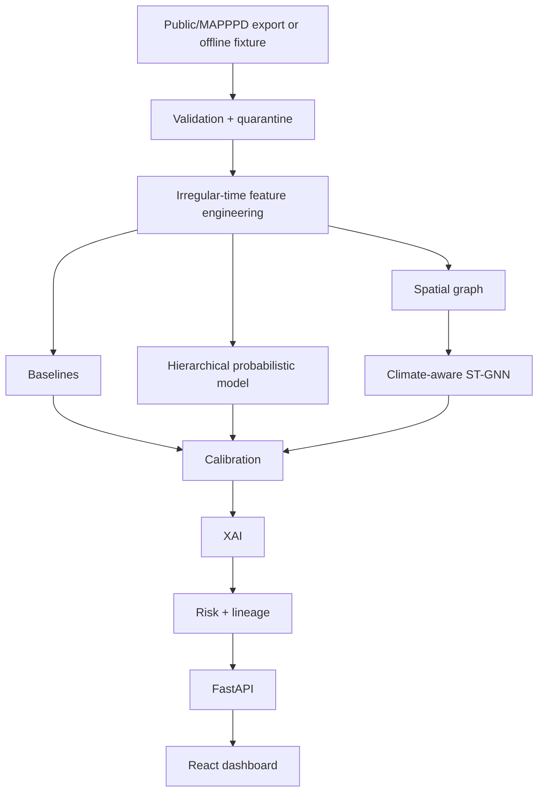

# Climate-Aware Spatio-Temporal Graph Neural Network for Antarctic Penguin Colony Population Forecasting from Irregular Survey Records

## Review 2 capstone implementation
This repository is a complete operable software/data-science system: ingestion and validation, irregular-survey feature handling, persistence + statistical baselines, hierarchical probabilistic model, pure-PyTorch ST-GNN, calibrated uncertainty intervals, explainability, lineage, FastAPI, React/Vite dashboard, SQLite-ready storage design, sensor simulation, Docker, CI, acceptance/negative tests, and offline fixture data.

**Data policy:** the included dataset is a realistic **synthetic fixture** for offline demonstration. It is not MAPPPD data. The pipeline is structured so a verified public MAPPPD/reference export can replace the fixture.

## Mac M4 quick start
```bash
python3 -m venv .venv
source .venv/bin/activate
python3 -m pip install -r requirements.txt
cd frontend && npm install && cd ..
./run_demo.sh
```
Backend: http://127.0.0.1:8000  | Swagger: http://127.0.0.1:8000/docs | Frontend: http://127.0.0.1:5173

For a non-blocking demo pipeline only: `python scripts/run_demo.py`.

## Tests
`pytest -q` or `python scripts/run_all_tests.py`.
Acceptance: `python scripts/run_acceptance.py`.
Negative tests: `python scripts/run_negative_tests.py`.
Full training: `python scripts/train_stgnn.py`.
Baseline: `python scripts/run_baseline.py`.
Hierarchical model: `python scripts/train_hierarchical.py`.

## Docker
`docker compose up --build`

## Architecture


## Model notes
The ST-GNN uses a GRU temporal encoder and pure-PyTorch graph message passing, avoiding PyTorch Geometric installation issues on Apple Silicon. Node features include population, climate covariates, time delta and observation mask. The observation-process concept is represented through survey method/quality and observation uncertainty in the schema and degraded-risk handling. Prediction intervals use residual-based conformal-style calibration with an explicit multiplier for sparse observations, large time gaps and low survey quality.

The project reports actual metrics; it never hardcodes KPI success. Reviewers should use `metrics/latest_run.json` and `metrics/baseline_metrics.csv` as evidence.

## Hardware partial prototype
`python scripts/simulate_sensor.py` emits JSON sensor readings for temperature, sea ice and ocean condition. A serial/JSON adapter can feed the same validation/API path. Physical hardware is optional.

## GitHub
```bash
git init
git add .
git commit -m "Initial complete capstone implementation"
```
No secrets are included. See `.env.example`.
